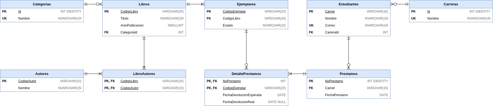

# Prueba técnica de Datos: Sistema de Gestión de Biblioteca

Motor: Microsoft SQL Server 2025 Express. Compatible con SQL Server 2017 o superior

| Archivo                                                      | Contenido                                                         |
| ------------------------------------------------------------ | ----------------------------------------------------------------- |
| Solucion.md                                                  | Partes 1 a 4: análisis, DER, normalización y diseño relacional    |
| [sql/01_creacion_tablas.sql](sql/01_creacion_tablas.sql)     | Parte 5.A: base de datos, tablas, llaves, restricciones e índices |
| [sql/02_vistas.sql](sql/02_vistas.sql)                       | Parte 5.B: las 4 vistas solicitadas                               |
| [sql/03_datos_prueba.sql](sql/03_datos_prueba.sql)           | Datos de ejemplo (adicional)                                      |
| [sql/04_consultas_ejemplo.sql](sql/04_consultas_ejemplo.sql) | Uso de las vistas (adicional)                                     |

Los scripts se ejecutan en orden: 01, 02, 03 y 04.

---

## Parte 1: Análisis

| Entidad          | Atributos                                                                | Observaciones                                            |
| ---------------- | ------------------------------------------------------------------------ | -------------------------------------------------------- |
| Libros           | Código, Título, Año de publicación, Categoría                            | El código es único                                       |
| Autores          | Código, Nombre                                                           |                                                          |
| LibroAutores     | Código libro, Código autor                                               | Resuelve la relación muchos a muchos entre Libro y Autor |
| Categorias       | Id, Nombre                                                               | Catálogo; una categoría agrupa muchos libros             |
| Ejemplares       | Código, Libro, Estado                                                    | Copia física de un libro; el código es único             |
| Estudiantes      | Carnet, Nombre, Correo, Carrera                                          |                                                          |
| Carreras         | Id, Nombre                                                               | Catálogo; una carrera tiene muchos estudiantes           |
| Prestamos        | No. préstamo, Estudiante, Fecha de préstamo                              | Encabezado de la transacción                             |
| DetallePrestamos | No. préstamo, Ejemplar, Fecha devolución esperada, Fecha devolución real | Ejemplares incluidos en el préstamo                      |

Relaciones de negocio:

- Un libro tiene uno o varios autores, y un autor escribe uno o varios libros (N:M, a través de LibroAutores).
- Una categoría clasifica muchos libros; cada libro tiene una categoría (1:N).
- Un libro tiene uno o varios ejemplares; cada ejemplar es de un libro (1:N).
- Una carrera tiene muchos estudiantes; cada estudiante pertenece a una carrera (1:N).
- Un estudiante realiza cero o muchos préstamos; cada préstamo es de un estudiante (1:N).
- Un préstamo incluye uno o varios ejemplares, y un ejemplar aparece en muchos préstamos a lo largo del tiempo (N:M, a través de DetallePrestamos).

---

## Parte 2: Diagrama Entidad Relación

## 

## Parte 3: Normalización

### 1FN: Primera Forma Normal

```
PrestamoBiblioteca (NoPrestamo PK, CodigoEjemplar PK, CodigoAutor PK,
                    FechaPrestamo, CarnetEstudiante, NombreEstudiante, Carrera,
                    CodigoLibro, TituloLibro, Categoria, NombreAutor, EstadoEjemplar)
```

| NoPrestamo | CodigoEjemplar | CodigoAutor | FechaPrestamo | Carnet    | NombreEstudiante | Carrera       | CodigoLibro | TituloLibro       | Categoria      | NombreAutor  | EstadoEjemplar |
| ---------- | -------------- | ----------- | ------------- | --------- | ---------------- | ------------- | ----------- | ----------------- | -------------- | ------------ | -------------- |
| 1          | EJ-001         | AUT-001     | 2026-10-01    | 2021-0001 | Ana López        | Ing. Sistemas | LIB-001     | Fundamentos de BD | Bases de Datos | Silberschatz | Prestado       |
| 1          | EJ-001         | AUT-002     | 2026-10-01    | 2021-0001 | Ana López        | Ing. Sistemas | LIB-001     | Fundamentos de BD | Bases de Datos | Korth        | Prestado       |
| 1          | EJ-004         | AUT-004     | 2026-10-01    | 2021-0001 | Ana López        | Ing. Sistemas | LIB-002     | Intro. Algoritmos | Algoritmos     | Cormen       | Prestado       |

Justificación:

- Un préstamo puede incluir varios ejemplares y un libro varios autores; se separa cada combinación en su propia fila para que cada celda tenga un solo valor.
- La llave es (NoPrestamo, CodigoEjemplar, CodigoAutor): ninguna de sus partes identifica la fila por sí sola. CodigoLibro no se incluye porque lo determina el ejemplar.

### 2FN: Segunda Forma Normal

```
Prestamos        (NoPrestamo PK, FechaPrestamo, CarnetEstudiante, NombreEstudiante, Carrera)
DetallePrestamos (NoPrestamo PK/FK, CodigoEjemplar PK/FK)
Ejemplares       (CodigoEjemplar PK, CodigoLibro, TituloLibro, Categoria, EstadoEjemplar)
Autores          (CodigoAutor PK, NombreAutor)
LibroAutores     (CodigoLibro PK, CodigoAutor PK/FK)
```

Justificación: ningún atributo depende de la llave completa, cada uno depende solo de una parte.

| Atributos                                                  | Dependen de    | Nueva entidad |
| ---------------------------------------------------------- | -------------- | ------------- |
| FechaPrestamo, CarnetEstudiante, NombreEstudiante, Carrera | NoPrestamo     | Prestamos     |
| CodigoLibro, TituloLibro, Categoria, EstadoEjemplar        | CodigoEjemplar | Ejemplares    |
| NombreAutor                                                | CodigoAutor    | Autores       |

- DetallePrestamos conserva qué ejemplares incluye cada préstamo.
- El autor pertenece al libro, no al préstamo, por eso la relación pasa a LibroAutores.

### 3FN: Tercera Forma Normal

```
Categorias       (Id PK, Nombre)
Carreras         (Id PK, Nombre)
Autores          (CodigoAutor PK, Nombre)
Libros           (CodigoLibro PK, Titulo, AnioPublicacion, CategoriaId FK)
LibroAutores     (CodigoLibro PK/FK, CodigoAutor PK/FK)
Ejemplares       (CodigoEjemplar PK, CodigoLibro FK, Estado)
Estudiantes      (Carnet PK, Nombre, Correo, CarreraId FK)
Prestamos        (NoPrestamo PK, Carnet FK, FechaPrestamo)
DetallePrestamos (NoPrestamo PK/FK, CodigoEjemplar PK/FK,
                  FechaDevolucionEsperada, FechaDevolucionReal)
```

Justificación: se eliminan las dependencias transitivas.

| Tabla       | Dependencia transitiva                                      | Nueva entidad |
| ----------- | ----------------------------------------------------------- | ------------- |
| Prestamos   | NoPrestamo -> CarnetEstudiante -> NombreEstudiante, Carrera | Estudiantes   |
| Ejemplares  | CodigoEjemplar -> CodigoLibro -> TituloLibro, Categoria     | Libros        |
| Estudiantes | Carnet -> Carrera                                           | Carreras      |
| Libros      | CodigoLibro -> Categoria                                    | Categorias    |

- Estado permanece en Ejemplares porque depende de cada copia física.
- AnioPublicacion, Correo, FechaDevolucionEsperada y FechaDevolucionReal no estaban en la tabla original; se agregan porque el enunciado los pide.

---

## Parte 4: Diseño Relacional

### Categorias

| Campo  | Tipo          | Llave | Nulo | Restricciones          |
| ------ | ------------- | ----- | ---- | ---------------------- |
| Id     | INT IDENTITY  | PK    | No   |                        |
| Nombre | NVARCHAR(100) |       | No   | UNIQUE; CHECK no vacío |

### Carreras

| Campo  | Tipo          | Llave | Nulo | Restricciones          |
| ------ | ------------- | ----- | ---- | ---------------------- |
| Id     | INT IDENTITY  | PK    | No   |                        |
| Nombre | NVARCHAR(150) |       | No   | UNIQUE; CHECK no vacío |

### Autores

| Campo       | Tipo          | Llave | Nulo | Restricciones  |
| ----------- | ------------- | ----- | ---- | -------------- |
| CodigoAutor | VARCHAR(10)   | PK    | No   |                |
| Nombre      | NVARCHAR(150) |       | No   | CHECK no vacío |

### Libros

| Campo           | Tipo          | Llave           | Nulo | Restricciones           |
| --------------- | ------------- | --------------- | ---- | ----------------------- |
| CodigoLibro     | VARCHAR(20)   | PK              | No   |                         |
| Titulo          | NVARCHAR(250) |                 | No   | CHECK no vacío          |
| AnioPublicacion | SMALLINT      |                 | No   | CHECK entre 1000 y 9999 |
| CategoriaId     | INT           | FK (Categorias) | No   |                         |

### LibroAutores

| Campo       | Tipo        | Llave            | Nulo | Restricciones |
| ----------- | ----------- | ---------------- | ---- | ------------- |
| CodigoLibro | VARCHAR(20) | PK, FK (Libros)  | No   |               |
| CodigoAutor | VARCHAR(10) | PK, FK (Autores) | No   |               |

### Ejemplares

| Campo          | Tipo         | Llave       | Nulo | Restricciones                                                     |
| -------------- | ------------ | ----------- | ---- | ----------------------------------------------------------------- |
| CodigoEjemplar | VARCHAR(20)  | PK          | No   |                                                                   |
| CodigoLibro    | VARCHAR(20)  | FK (Libros) | No   |                                                                   |
| Estado         | NVARCHAR(15) |             | No   | CHECK IN ('Disponible','Prestado','Dañado'); DEFAULT 'Disponible' |

### Estudiantes

| Campo     | Tipo          | Llave         | Nulo | Restricciones                          |
| --------- | ------------- | ------------- | ---- | -------------------------------------- |
| Carnet    | VARCHAR(15)   | PK            | No   |                                        |
| Nombre    | NVARCHAR(150) |               | No   | CHECK no vacío                         |
| Correo    | NVARCHAR(150) |               | No   | UNIQUE; CHECK formato básico de correo |
| CarreraId | INT           | FK (Carreras) | No   |                                        |

### Prestamos

| Campo         | Tipo         | Llave            | Nulo | Restricciones        |
| ------------- | ------------ | ---------------- | ---- | -------------------- |
| NoPrestamo    | INT IDENTITY | PK               | No   |                      |
| Carnet        | VARCHAR(15)  | FK (Estudiantes) | No   |                      |
| FechaPrestamo | DATE         |                  | No   | DEFAULT fecha actual |

### DetallePrestamos

| Campo                   | Tipo        | Llave               | Nulo | Restricciones                                                           |
| ----------------------- | ----------- | ------------------- | ---- | ----------------------------------------------------------------------- |
| NoPrestamo              | INT         | PK, FK (Prestamos)  | No   |                                                                         |
| CodigoEjemplar          | VARCHAR(20) | PK, FK (Ejemplares) | No   | Índice único filtrado: un ejemplar solo puede tener un préstamo abierto |
| FechaDevolucionEsperada | DATE        |                     | No   |                                                                         |
| FechaDevolucionReal     | DATE        |                     | Sí   | NULL = no devuelto                                                      |

### Decisiones técnicas

- Llaves naturales en libros, ejemplares, autores y estudiantes (CodigoLibro, CodigoEjemplar, CodigoAutor, Carnet).
- Llaves IDENTITY en catálogos y préstamos.
- NVARCHAR en textos y VARCHAR en códigos.
- DATE en las fechas de préstamo y devolución.
- Índice único filtrado UX_DetallePrestamos_EjemplarAbierto para impedir prestar un ejemplar no devuelto.
- Índices en las llaves foráneas usadas por las vistas.
- Un ejemplar está prestado cuando FechaDevolucionReal es NULL; Ejemplares.Estado indica su condición física.

---

## Parte 5: SQL

Ver los scripts en la carpeta [sql/](sql/).

| Vista                                | Requisito                               | Detalle                                                                                                                                                          |
| ------------------------------------ | --------------------------------------- | ---------------------------------------------------------------------------------------------------------------------------------------------------------------- |
| VW_LIBROS_CON_AUTORES                | 1. Libros con sus autores               | Una fila por libro, autores concatenados con STRING_AGG                                                                                                          |
| VW_PRESTAMOS_POR_ESTUDIANTE          | 2. Préstamos de un estudiante           | Una vista no admite parámetros: se filtra con WHERE Carnet = '...'. Se incluye además la función FN_PRESTAMOS_ESTUDIANTE(@Carnet) como alternativa parametrizada |
| VW_LIBROS_PRESTADOS                  | 3. Libros prestados actualmente         | Ejemplares sin fecha de devolución real, con días de atraso                                                                                                      |
| VW_CANTIDAD_PRESTAMOS_POR_ESTUDIANTE | 4. Cantidad de préstamos por estudiante | Incluye estudiantes con 0 préstamos; cuenta préstamos y ejemplares                                                                                               |
